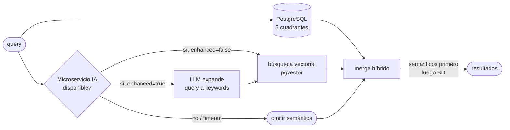
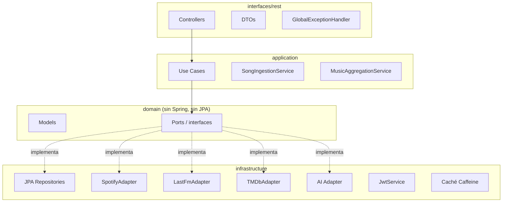
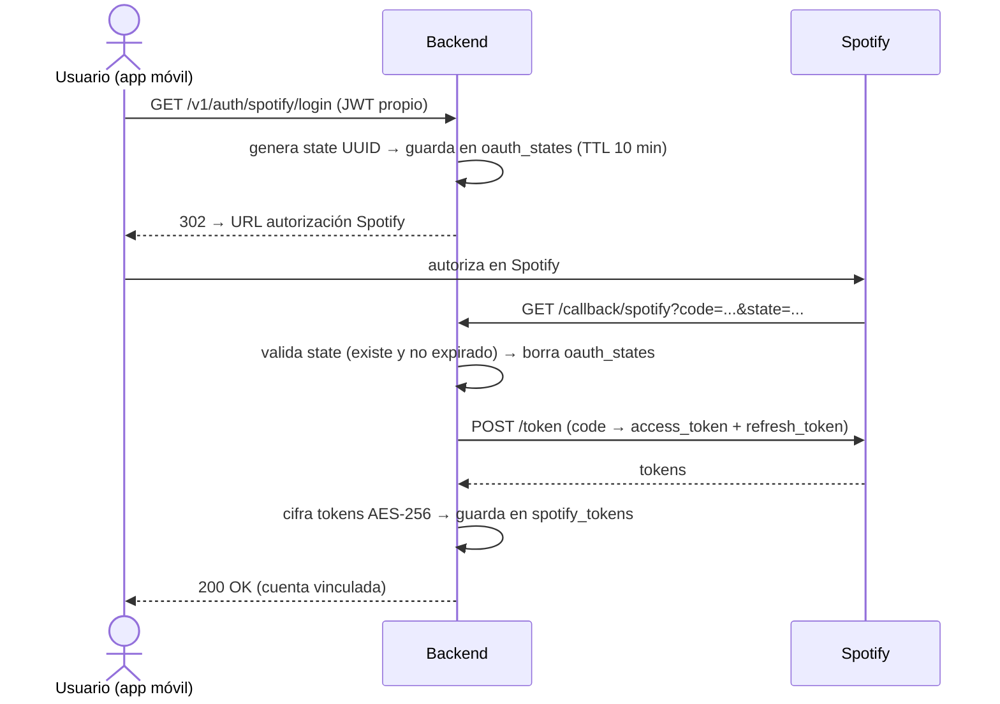

# ECOS — Backend

> Backend de la aplicación móvil **ECOS**: descubrimiento musical inteligente a través de un grafo neuronal interactivo.

---

## ¿Qué es ECOS?

ECOS es una app móvil donde el usuario no "busca" música, sino que **viaja** a través de ella. Cada canción es un nodo en un grafo interactivo con conexiones hacia otras canciones basadas en dimensiones culturales, técnicas, temporales y cinematográficas.

Este repositorio contiene el **backend Spring Boot** que alimenta la app.

---

## Stack

| Capa | Tecnología |
|---|---|
| Framework | Spring Boot 4.0.2 · Java 21 |
| Base de datos | PostgreSQL 16 + extensión `pgvector` |
| Migraciones | Flyway (V1–V28) |
| APIs externas | Spotify · Last.fm · TMDb · MusicBrainz |
| IA / Semántica | Microservicio Python (FastAPI + pgvector + embeddings) |
| Seguridad | JWT (jjwt 0.12.6) · BCrypt · Spring Security · OAuth2 Spotify |
| Cola async | Redis (jobs de exportación a Spotify) |
| Caché | Caffeine (in-memory, TTL por capa) |
| Tests | JUnit 5 · Mockito · Testcontainers · MockRestServiceServer |
| Docs API | SpringDoc OpenAPI (Swagger UI) |

---

## Requisitos previos

- **Java 21** o superior
- **Docker Desktop** en ejecución (para PostgreSQL y Redis locales)
- Cuentas de desarrollador con claves de API:
  - [Spotify for Developers](https://developer.spotify.com)
  - [The Movie Database (TMDb)](https://www.themoviedb.org/settings/api)
  - [Last.fm API](https://www.last.fm/api/account/create)
- (Opcional) Microservicio de IA desplegado para búsqueda semántica y recomendaciones

---

## Arrancar en local

### 1. Clonar el repositorio

```bash
git clone <url-del-repo>
cd Ecos-Backend
```

### 2. Configurar variables de entorno

Crear un fichero `.env` en la raíz (no se sube a Git):

```env
# Base de datos
DB_PASSWORD=tu_password_local

# Spotify (https://developer.spotify.com/dashboard)
SPOTIFY_CLIENT_ID=tu_client_id
SPOTIFY_CLIENT_SECRET=tu_client_secret
SPOTIFY_REDIRECT_URI=http://127.0.0.1:3000/callback/spotify

# TMDb (https://www.themoviedb.org/settings/api)
TMDB_API_KEY=tu_api_key
TMDB_API_TOKEN=tu_read_access_token

# Last.fm (https://www.last.fm/api/account/create)
LASTFM_API_KEY=tu_api_key

# JWT (cadena aleatoria >= 32 caracteres)
JWT_SECRET=cambia_esto_por_una_cadena_aleatoria_larga

# Cifrado AES para tokens OAuth en BD
ENCRYPTION_KEY=tu_clave_cifrado
ENCRYPTION_SALT=deadbeefdeadbeef

# Admin (protege /v1/admin/**)
ADMIN_API_KEY=clave_secreta_larga

# Microservicio de IA (opcional — sin esta variable la búsqueda semántica se omite)
AI_SERVICE_URL=https://tu-micro-ia.railway.app
AI_SERVICE_API_KEY=tu_api_key_del_micro
```

### 3. Iniciar PostgreSQL y Redis con Docker

```bash
docker run -d \
  --name ecos_postgres \
  -e POSTGRES_DB=ecos_db \
  -e POSTGRES_USER=ecos \
  -e POSTGRES_PASSWORD=tu_password_local \
  -p 5432:5432 \
  pgvector/pgvector:pg16

docker run -d \
  --name ecos_redis \
  -p 6379:6379 \
  redis:7-alpine
```

Flyway aplica las migraciones automáticamente al arrancar.

### 4. Arrancar la aplicación

```bash
./mvnw spring-boot:run
```

La API queda disponible en `http://localhost:3000`.  
Documentación interactiva: `http://localhost:3000/swagger-ui.html`

---

## Endpoints principales

```
# Autenticación
POST /v1/auth/login                        body: {email, password} → {token, userId}
GET  /v1/auth/spotify                      login con Spotify (público)
POST /v1/users                             body: {username, email, password, language}

# Usuarios
GET    /v1/users/{id}
PATCH  /v1/users/{id}                      body: {username?, language?}
PATCH  /v1/users/{id}/password             body: {currentPassword, newPassword}

# Búsqueda multidimensional
GET  /v1/search?q=&aesthetic=&decade=&movie=&genre=&country=&instrumental=&...
GET  /v1/search?q=canciones+tristes&enhanced=true   # modo imaginario (LLM)

# Sugerencias (autocompletado)
GET  /v1/suggestions?type=movie|aesthetic|genre|artist|country&q=

# Canciones
GET  /v1/songs/{id}
GET  /v1/songs/{id}/related

# Interacciones
POST /v1/interactions                      body: {songId, action, durationMs?}

# Recomendaciones
GET  /v1/recommendations
GET  /v1/recommendations/crossover?userBId=

# Playlists
GET    /v1/playlists
POST   /v1/playlists
GET    /v1/playlists/{id}
PATCH  /v1/playlists/{id}                  body: {name?, description?}
DELETE /v1/playlists/{id}
POST   /v1/playlists/{id}/songs
DELETE /v1/playlists/{id}/songs/{songId}
POST   /v1/playlists/{id}/export/spotify       → 202 {jobId, status}
GET    /v1/playlists/{id}/export/spotify/{jobId}  → estado del job

# Sesiones del grafo
GET  /v1/sessions
POST /v1/sessions                          body: {startSongId}
GET  /v1/sessions/{id}
POST /v1/sessions/{id}/nodes               body: {songId, x, y}

# OAuth Spotify
GET  /v1/auth/spotify/login                vincula cuenta Spotify (🔒)
GET  /callback/spotify                     callback OAuth (solo Spotify → backend)

# Diagnóstico
GET  /health
```

Todos los endpoints excepto login, registro, `/v1/auth/spotify` y health requieren:
```
Authorization: Bearer <token>
```

Documentación completa: `docs/API_ENDPOINTS.md`

---

## Búsqueda semántica

El backend integra un **microservicio de IA** (FastAPI + Python) para búsqueda vectorial y recomendaciones personalizadas. La integración es opcional y tolerante a fallos: si el micro no está disponible, los resultados de BD se devuelven sin error.

| Modo | Parámetro | Descripción |
|---|---|---|
| Semántica directa | `enhanced=false` (defecto) | Codifica la query y busca vectores más cercanos |
| Modo imaginario | `enhanced=true` | Un LLM expande la query a keywords antes de buscar — ideal para frases evocadoras como "canciones tristes" o "música para una boda" |



Los resultados del micro se **mezclan con los de BD** (merge híbrido): los matches semánticos aparecen primero ordenados por score, seguidos de los resultados de BD sin match semántico.

---

## Tests

```bash
# Tests unitarios y de slice (sin Docker)
./mvnw test -Dgroups="!functional"

# Suite completa (requiere Docker para Testcontainers)
./mvnw test
```

| Suite | Tests |
|---|---|
| Use cases (Mockito) | 27 |
| Controllers (`@WebMvcTest`) | 48 |
| SemanticSearchClient (MockRestServiceServer) | 7 |
| Funcionales (Testcontainers) | 18 |
| BackendApplicationTests | 1 |
| **Total** | **~305** |

Los tests funcionales arrancan contenedores PostgreSQL y Redis reales. Requieren Docker Desktop en ejecución.

---

## Arquitectura

El backend sigue la **arquitectura hexagonal (Ports & Adapters)**:



El dominio no depende de nada externo. La infraestructura implementa los Ports del dominio (inversión de dependencia).

---

## Flujo OAuth con Spotify



---

## Variables de entorno

| Variable | Descripción | Requerida |
|---|---|---|
| `DB_PASSWORD` | Contraseña de PostgreSQL | Sí |
| `SPOTIFY_CLIENT_ID` | Client ID de Spotify | Sí |
| `SPOTIFY_CLIENT_SECRET` | Client Secret de Spotify | Sí |
| `SPOTIFY_REDIRECT_URI` | URI de callback OAuth (default: `http://127.0.0.1:3000/callback/spotify`) | No |
| `TMDB_API_KEY` | API Key de TMDb | Sí |
| `TMDB_API_TOKEN` | Read Access Token de TMDb | Sí |
| `LASTFM_API_KEY` | API Key de Last.fm | Sí |
| `JWT_SECRET` | Clave HMAC-SHA256 para tokens JWT (mín. 32 chars) | Sí |
| `JWT_EXPIRATION_MS` | Duración del token en ms (default: `86400000` = 24 h) | No |
| `ENCRYPTION_KEY` | Clave para cifrado AES-256 de tokens OAuth en BD | Sí |
| `ENCRYPTION_SALT` | Salt hexadecimal de exactamente 16 chars (ej: `deadbeefdeadbeef`) | Sí |
| `ADMIN_API_KEY` | Clave para proteger `/v1/admin/**` (mín. 32 chars recomendado) | Sí |
| `CORS_ALLOWED_ORIGINS` | Orígenes permitidos separados por coma | No (default: localhost) |
| `APP_DEEP_LINK_SCHEME` | Scheme del deep link móvil (default: `ecos`) | No |
| `AI_SERVICE_URL` | URL base del microservicio de IA (sin barra final) | No |
| `AI_SERVICE_API_KEY` | API key del microservicio de IA | No |
| `REDIS_HOST` | Host de Redis (default: `localhost`) | No (local) |
| `REDIS_PORT` | Puerto de Redis (default: `6379`) | No (local) |
| `REDIS_PASSWORD` | Contraseña de Redis si requiere autenticación | No |
| `REDIS_URL` | URL completa de Redis — Railway la genera automáticamente | Sí (prod) |

---

## Licencia

MIT © 2026 [Wara Yasy Pacheco Arandia](LICENSE)